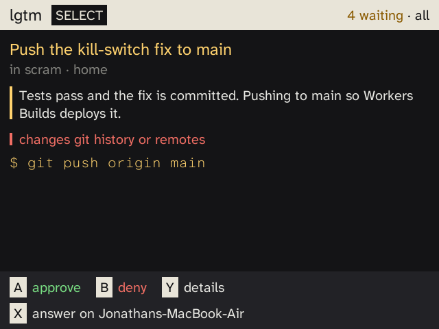
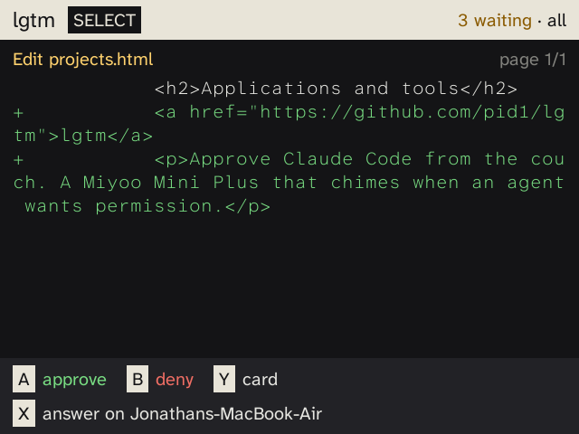
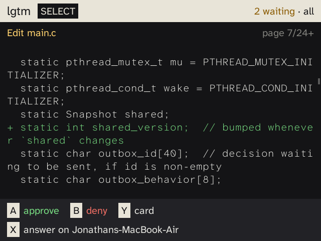
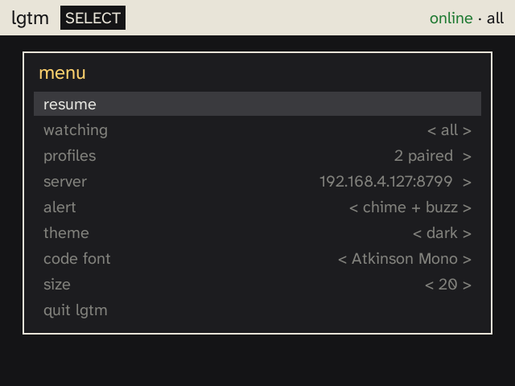
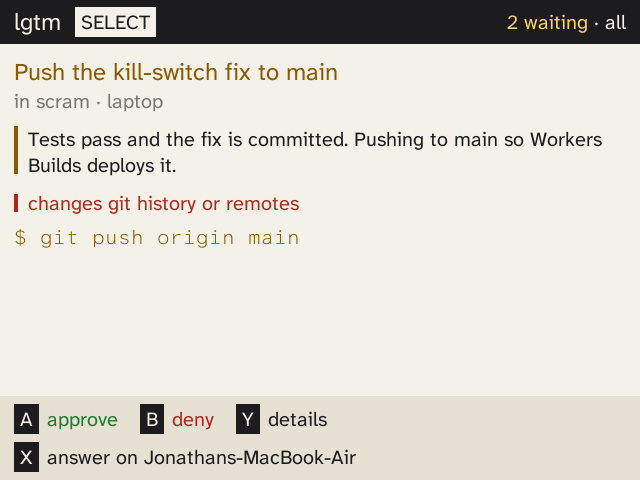
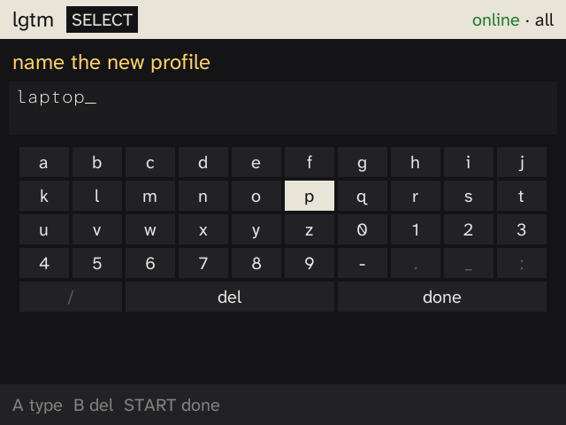
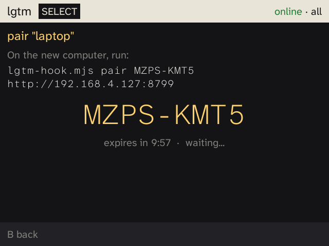

# lgtm

Approve Claude Code from the couch. When Claude Code asks for permission, a
Miyoo Mini Plus chimes and shows a decision card: what it wants to do, why
Claude says it's doing it, and anything worth a second look. **A** approves,
**B** denies, **Y** opens the full diff or command, and **X** sends it back
to the computer that asked.

<p>


</p>

```
Claude Code ──PermissionRequest hook──▶ Worker (lgtm.pid1.space) ◀──polls── Miyoo
     ▲                                        │
     └──────────── approve / deny ◀───────────┘
```

It fails open to the computer, never to "approve". If the Miyoo isn't
watching (off, asleep, on another profile), the hook falls straight through
to Claude Code's normal prompt. The same happens on a network error, a
timeout, or **X**. While the hook waits, the prompt on the computer is held,
so answer on the Miyoo or wait out `LGTM_WAIT` (default 120s).

## On the Miyoo

| Button | Action |
| --- | --- |
| A | approve |
| B | deny |
| Y | details: the full diff or command, paged; again for the card |
| X | answer on the computer that asked (named on the button) |
| Up/Down, L1/R1 | scroll, page (in details) |
| SELECT | menu |

A new request plays a soft chime and buzzes; the **alert** setting picks
chime, buzz, both, or neither. Decisions are ignored for 700 ms after a
request appears, so a press meant for the last one can't land on the next.

Long diffs load 200 lines at a time as you page into them. Nothing is cut
off, and approving never requires reading to the end.

<p>


</p>

The menu picks which profile to watch, manages profiles, edits the server
URL, and sets alert, theme (dark or light), code font, and text size. UI
text is Atkinson Hyperlegible Next; code is Atkinson Hyperlegible Mono by
default.

<p>


</p>

## Profiles and pairing

Each computer is a profile (`home`, `work`, ...) with its own hook token and
its own queue. The Miyoo watches one profile or all of them; prompts from a
profile it isn't watching stay on that computer.

To add one: **SELECT → profiles → + add profile**, name it, and the Miyoo
shows a pairing code. On the new computer:

```sh
curl -fsSLo ~/.local/bin/lgtm-hook.mjs https://github.com/pid1/lgtm/releases/latest/download/lgtm-hook.mjs
chmod +x ~/.local/bin/lgtm-hook.mjs
lgtm-hook.mjs pair K7QM-2XRD https://lgtm.pid1.space
```

That writes `~/.config/lgtm/config` (mode 600) and prints the hook entry for
`~/.claude/settings.json`:

```json
{
  "hooks": {
    "PermissionRequest": [
      { "matcher": "*", "hooks": [{ "type": "command", "command": "~/.local/bin/lgtm-hook.mjs", "timeout": 150 }] }
    ]
  }
}
```

Re-pairing a profile rotates its token; removing one revokes it at once and
drops anything it had queued. For a single session, `LGTM_DISABLE=1 claude`
skips the Miyoo entirely.

<p>


</p>

## Security

- Every route needs a token except one: trading a pairing code for a hook
  token. Codes are 40 random bits, single use, expire in 10 minutes, and
  10 wrong guesses cancel every open code.
- Hook tokens can only submit to and poll their own profile. Only the
  device token can read requests or decide, so a leaked hook token can't
  approve anything.
- Only SHA-256 hashes of tokens are stored (`worker/keys.json` and the
  Registry Durable Object), compared in constant time.
- Request contents (commands, diffs, Claude's reasoning) are deleted as soon
  as they're answered, or after 15 minutes.
- The Worker is served only at `lgtm.pid1.space`; `workers.dev` and preview
  URLs are off.
- The weak spot is the handheld: the device token is in `config.txt` on the
  SD card, and Onion's SSH is root with a well-known password. Keep SSH off
  when you aren't deploying, and rotate the device token
  (`npm run key -- device miyoo`, redeploy) if the card leaves your hands.

## Setting up

**Miyoo** (Onion OS, Wi-Fi on, NTP time sync on so TLS works): download
`lgtm-miyoo.zip` from the latest release and extract it onto the SD card.
Create `App/lgtm/config.txt`:

```
URL=https://lgtm.pid1.space
TOKEN=<device token>
```

**Worker**: the device token comes from `npm run key -- device miyoo` in
`worker/`, which prints it once and records only its hash in `keys.json`.
Publishing a GitHub release deploys the Worker to `lgtm.pid1.space` and
attaches the Miyoo zip and the hook script (`.github/workflows/release.yml`).

## Development

```sh
cd worker && npm install && npm run dev      # local Worker on :8787
make -C miyoo                                # cross-compile (Docker)
make -C miyoo deploy DEVICE=onion@<miyoo-ip> # push to the Miyoo over SSH
```

The Miyoo client is C with SDL 1.2, built in the
`aemiii91/miyoomini-toolchain` image. HTTPS on the device is a bundled
static curl, downloaded and checksum-verified at build time along with
Mozilla's CA bundle. The device protocol is plain text so the client needs
no JSON parser.

Fonts are under the SIL Open Font License; see `miyoo/vendor/fonts/`.
